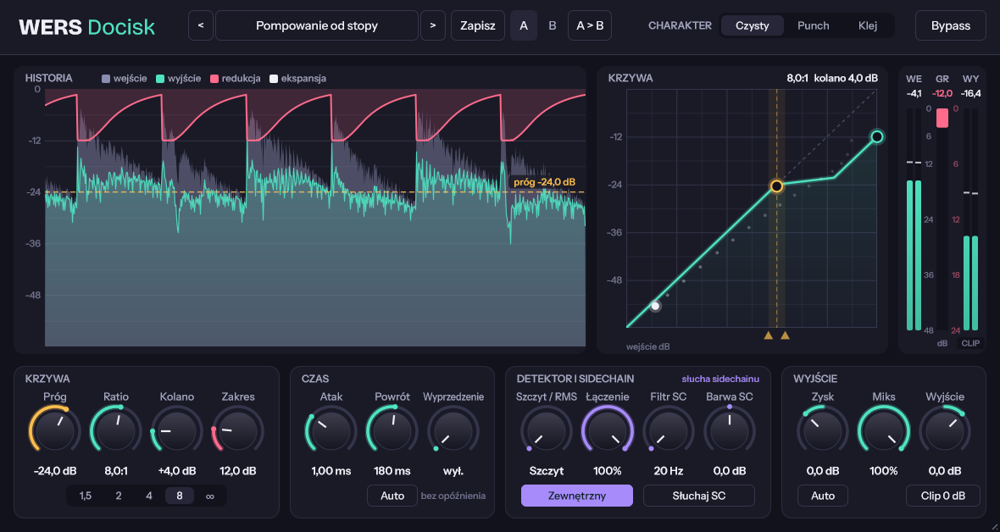

# WERS Docisk



Kompresor serii WERS: VST3 na Windows, czysty i precyzyjny, od przezroczystego wyrównania po mocne, nowoczesne dociśnięcie. Ma wszystko, czego potrzeba w miksie: miękkie kolano, zakres, automatyczny powrót, wyprzedzenie, kompresję równoległą, zewnętrzny sidechain z filtrem i miękki clip na wyjściu. Pokazuje przy tym, co robi: przewijaną historię wejścia, wyjścia i redukcji, krzywą, którą można przeciągać myszą, oraz mierniki.

Druga wtyczka dynamiki w serii, **WERS Lampa**, ma charakter i barwę. Docisk jest od tego, żeby nic nie barwić.

## Instalacja

1. Kliknij dwa razy `zainstaluj.bat` w tym folderze. Windows zapyta o zgodę, bo folder `C:\Program Files\Common Files\VST3` wymaga uprawnień administratora.
2. W DAW włącz ponowne skanowanie wtyczek. Szukaj **WERS Docisk** (kategoria Fx / Dynamics).

Bez instalatora wystarczy skopiować cały folder `WERS Docisk.vst3` tam, gdzie DAW szuka wtyczek.

## Jak się tym gra

**Historia** (duże okno po lewej) przewija ostatnie ponad trzy sekundy:
- szare to wejście, miętowe to wyjście, oba w dBFS;
- koralowa linia zwisa z góry i pokazuje redukcję w tej samej skali: linia na −12 to 12 dB redukcji;
- biała linia w tym samym miejscu to ekspansja w górę (ratio poniżej 1:1);
- bursztynowa przerywana linia to próg: **przeciągnij ją w górę albo w dół**.

**Krzywa** (środek) pokazuje, jak poziom wejścia zamienia się w poziom wyjścia. Biała kropka to sygnał teraz, a koralowa kreska pod nią to bieżąca redukcja. Wszystko da się przeciągać:
- **kółko na krzywej** w bok zmienia próg (cała przerywana pionowa linia też działa);
- **kółko z prawej** w górę i w dół zmienia ratio: na wysokości przekątnej to 1:1, na wysokości progu to ∞:1;
- **dwa trójkąty pod krzywą** rozsuwają kolano, a jego zasięg widać jako bursztynowy pas.

**Shift** przeciąga pięć razy dokładniej, **Ctrl-klik** i **dwuklik** przywracają wartość domyślną. Podczas przeciągania obok uchwytu widać wartość.

**Mierniki** (po prawej): wejście L/P, redukcja (GR) i wyjście L/P. Liczby na górze to szczyty z ostatnich trzech sekund; kliknięcie je zeruje. Lampka **CLIP** zapala się, kiedy miękki clip coś zaokrąglił.

**Charakter** (u góry) wybiera konstrukcję detektora. Wszystkie trzy są czyste i dochodzą do tej samej krzywej statycznej, różnią się tym, jak się do niej dostają:
- **Czysty**: detektor w przód, czasy dokładnie takie jak na pokrętłach. Przezroczysty i przewidywalny.
- **Punch**: atak w dwóch stopniach. Pierwsze milisekundy uderzenia przechodzą prawie nietknięte, a potem kompresor łapie tak samo mocno. Więcej ataku przy tym samym czasie.
- **Klej**: sprzężenie zwrotne, detektor słucha już ściśniętego sygnału. Łagodniej wchodzi w kompresję i szybciej puszcza, kiedy poziom spada, ale nadal jest powyżej progu. Spaja ślady.

Przełączanie charakteru, presetów i każdego pokrętła w trakcie grania jest płynne.

### Pokrętła

**Krzywa**
- **Próg**: od −60 do 0 dB. Pod pokrętłami są przyciski szybkiego ratio: 1,5, 2, 4, 8 i ∞.
- **Ratio**: od 1:1 do ∞:1. Na samym dole, poniżej 1:1 (do 1:2), głośne miejsca rosną zamiast maleć: to **ekspansja w górę**, która przywraca życie przeciśniętym bębnom.
- **Kolano**: od 0 (ostry próg) do 24 dB łagodnego przejścia.
- **Zakres**: najwięcej, ile kompresor może zabrać (albo dodać przy ekspansji). Na samej górze bez limitu. Przy małym zakresie nawet ostra kompresja zostaje subtelna.

**Czas**
- **Atak**: od 0,05 do 250 ms. Krótki tłumi uderzenia, długi je przepuszcza.
- **Powrót**: od 5 ms do 2,5 s. Przycisk **Auto** włącza powrót zależny od materiału: po krótkim uderzeniu kompresor puszcza cztery razy szybciej, a po długiej kompresji tak wolno, jak ustawia pokrętło. Nie pompuje i nie dławi.
- **Wyprzedzenie**: od 0 do 10 ms. Kompresor słyszy dźwięk wcześniej i redukcja jest gotowa, zanim przyjdzie uderzenie. Tyle samo opóźnienia dostaje sygnał, a DAW je wyrównuje. Pod pokrętłem widać opóźnienie w próbkach.

**Detektor i sidechain**
- **Szczyt / RMS**: czego słucha detektor. Szczyt łapie każde uderzenie, RMS słucha średniej głośności, bliżej tego, jak słyszy ucho. Oba są skalibrowane tak, że równy sinus czytają tak samo, więc próg znaczy to samo przy każdym ustawieniu.
- **Łączenie**: 100% to jeden detektor dla obu kanałów (obraz stereo stoi w miejscu), 0% to każdy kanał osobno.
- **Filtr SC**: detektor nie słyszy basu poniżej tej częstotliwości (od 20 do 500 Hz), więc stopa i bas nie pompują całością.
- **Barwa SC**: przechyla to, co słyszy detektor, o ±6 dB wokół 1 kHz. W prawo kompresor bardziej reaguje na górę, w lewo na dół.
- **Zewnętrzny**: detektor słucha wejścia sidechain zamiast samego śladu. Podłącz sygnał w DAW (na przykład stopę). Nad pokrętłami pojawia się napis, czy sygnał dochodzi.
- **Słuchaj SC**: słyszysz to, co słyszy detektor, razem z filtrem i barwą. Nie zapisuje się w presetach.

**Wyjście**
- **Zysk**: od −12 do +24 dB po kompresji. Przycisk **Auto** sam dodaje mniej więcej tyle, ile kompresja zabrała: połowę redukcji, jaką dostałby głośny sygnał na −10 dBFS. Na prawdziwym materiale wychodzi blisko głośności wejścia, więc porównanie z bypassem jest uczciwe. Ile dodaje, widać nad pokrętłami.
- **Miks**: ile skompresowanego sygnału w wyjściu. Poniżej 100% to kompresja równoległa: oryginał zostaje pod spodem, w tym samym czasie co kompresja.
- **Wyjście**: głośność na samym końcu.
- **Clip 0 dB**: miękki clip na samym wyjściu, liczony przy czterokrotnym nadpróbkowaniu. Do −1,5 dBFS nic nie rusza, wyżej łagodnie zaokrągla szczyty, które nigdy nie przekraczają pełnej skali.

**Bypass** płynnie przechodzi do czystego sygnału, opóźnionego tak samo jak wyjście, więc nic nie przeskakuje w czasie.

## Presety

27 presetów fabrycznych w grupach:

| Grupa | Presety |
|---|---|
| **Start** | Neutralnie |
| **Wokal** | Wokal: równo, Wokal: do przodu, Wokal: gęsto, Lektor i podcast |
| **Bębny** | Stopa: atak, Werbel: trzask, Bębny: zwarte, Room: zgniecione, Bębny: więcej życia |
| **Bas** | Bas: równy, Bas: ciasny, Bas syntezatorowy |
| **Miks** | Klej na sumę, Gitary na szynie, Pianino łagodnie, Akustyk |
| **Master** | Master: przezroczyście, Master: głośniej, Ogranicznik |
| **Równoległa** | Nowojorska na bębny, Wokal równoległy, Gęsty środek |
| **Sidechain** | Pompowanie od stopy, Bas ustępuje stopie, Podkład ustępuje głosowi, Syczące spółgłoski |

Presety z grupy Sidechain (poza „Syczącymi spółgłoskami”, które słuchają samego śladu przez filtr) potrzebują sygnału na wejściu sidechain. Własne presety zapisują się w `%APPDATA%\WERS\presets\docisk`. Sloty A/B pozwalają porównać dwa ustawienia.

W folderze `docisk/dema` jest każdy preset wyrenderowany na tej samej pętli (cztery takty głośno, cztery ciszej, żeby kompresor miał co robić) i plik `00 bez efektu.wav` do porównania. Presety sidechain dostały na wejście sidechain stopę na każdą ćwierćnutę, a „Podkład ustępuje głosowi” śpiewaną samogłoskę. Wszystkie rendery są wyrównane w czasie z plikiem bez efektu.

## Jak to działa

Na każdą próbkę:

1. **Klucz**, czyli to, czego słucha detektor: sam ślad albo wejście sidechain (z płynnym przejściem), potem filtr górnoprzepustowy 12 dB/okt. (filtr zmiennych stanu, który nie trzeszczy przy kręceniu) i pochylenie barwy wokół 1 kHz.
2. **Poziom**: mieszanka szczytu i RMS (10 ms, przemnożone przez √2, żeby sinus czytały tak samo) w dB, osobno dla kanałów, a potem łączenie stereo w stronę głośniejszego.
3. **Krzywa statyczna**: próg, ratio, kolano w postaci paraboli i zakres. Ta sama funkcja rysuje krzywą w oknie.
4. **Balistyka**, trzy konstrukcje liczone równolegle, żeby zmiana charakteru była płynnym przejściem:
   - Czysty: jeden biegun w dB w każdą stronę;
   - Punch: dwa bieguny o połowie czasu na ataku, jeden na powrocie;
   - Klej: sprzężenie zwrotne rozwiązywane bez opóźnienia w pętli (metodą Newtona z bisekcją jako asekuracją). Detektor słucha poziomu po redukcji, a funkcja, której używa, jest dokładnym odwróceniem krzywej, więc ustala się na tej samej krzywej co pozostałe. Atak jest wydłużony o ratio, żeby pokrętło mówiło prawdę.
   
   „Atak” to każdy ruch od zera: w dół przy kompresji, w górę przy ekspansji.
5. **Powrót automatyczny**: wolna pamięć redukcji narasta, póki kompresja trwa (pół sekundy), i powstrzymuje powrót. Krótkie szczyty jej nie budzą, więc puszczają szybko.
6. **Wyprzedzenie**: sygnał (i klucz do odsłuchu) idzie przez linię opóźniającą, a detektor pracuje na nieopóźnionym. Zmiana wyprzedzenia przechodzi płynnie przez 20 ms między starym a nowym opóźnieniem, a DAW dostaje nowe opóźnienie.
7. **Wyjście**: wzmocnienie, zysk, miks z opóźnionym czystym sygnałem, głośność, miękki clip i odsłuch klucza.

Miękki clip pracuje na czterokrotnej częstotliwości. Filtry półpasmowe to wielofazowe filtry IIR (dwie gałęzie filtrów wszechprzepustowych pierwszego rzędu, razem eliptyczny dolnoprzepustowy), więc opóźniają sygnał tylko o próbkę lub dwie i nie ma czego zgłaszać jako opóźnienia. Zniekształcenia aliasingu z przesterowanego tonu 7 kHz spadają z −25 dB do −84 dB.

Każdy parametr jest wygładzany, a czasy ataku i powrotu zmieniają się płynnie w skali logarytmicznej, więc nawet przeskok z 250 ms do 0,05 ms nie klika. Wątek audio niczego nie alokuje.

## Budowanie

Docisk to osobny projekt CMake w tym folderze:

```
cmake -S . -B build -G "Visual Studio 17 2022" -A x64
cmake --build build --config Release -- /m:3
build\Release\doc_dsp_tests.exe
build\Release\doc_plugin_tests.exe
```

Gotowa wtyczka jest w `build\WersDocisk_artefacts\Release\VST3\WERS Docisk.vst3`.

Dodatkowe programy:
- `doc_ui_shots <folder>` robi zrzuty okna w kilku stanach, z grającym dźwiękiem;
- `doc_render <folder> [plik.wav]` przepuszcza plik (albo pętlę demo) przez wszystkie presety.

### Co sprawdzają testy

**DSP** (22 przypadki, ponad 24 tysiące sprawdzeń):
- Krzywa statyczna z ostrym kolanem: przy ratio 2, 4 i 10 redukcja na każdym poziomie od −40 do 0 dB zgadza się z progiem i ratio co do 0,15 dB.
- Miękkie kolano trzyma się paraboli, ∞:1 trzyma wyjście na progu, a zakres zatrzymuje redukcję dokładnie na ustawionej wartości.
- Poniżej 1:1 sygnał rośnie o tyle, ile mówi ratio, ale nie więcej niż zakres. Na prawdziwej muzyce w każdym charakterze ekspansja tylko podnosi, nigdy nie ścisza.
- Wszystkie trzy charaktery ustalają się na tej samej krzywej, a odwrócona funkcja sprzężenia zwrotnego daje z powrotem dokładnie to samo wzmocnienie.
- Szczyt i RMS czytają równy sinus tak samo, a na serii krótkich kliknięć RMS ściska o ponad 6 dB mniej.
- Czasy ataku 1, 10 i 100 ms oraz powrotu 50, 500 i 2000 ms mierzone na sygnale (63% drogi) zgadzają się z pokrętłami co do 10–12%.
- Punch po 1 ms uderzenia zabiera mniej niż jedną trzecią tego, co Czysty, a pełną redukcję osiąga w podobnym czasie; Klej trzyma czas ataku.
- Powrót automatyczny: po uderzeniu 30 ms puszcza w około 100 ms, po trzech sekundach kompresji w około 500 ms (przy pokrętle 400 ms).
- Wyprzedzenie 5 ms opóźnia wszystko dokładnie o 240 próbek przy 48 kHz, a pierwsza milisekunda twardego uderzenia jest już ściszona o 24 dB (bez wyprzedzenia prawie wcale).
- Zewnętrzny sidechain ścisza ślad dokładnie o tyle, ile wynika z poziomu klucza, i tylko wtedy, gdy jest wybrany i podłączony. Filtr SC usuwa niski klucz, a barwa +12 dB dodaje 6 dB górze i zabiera 6 dB dołowi.
- Odsłuch SC daje klucz na jego własnym poziomie, bez śladu sygnału głównego.
- Miks 0% to sygnał wejściowy próbka w próbkę, 50% to dokładnie pół na pół, a zysk, wyjście i zysk automatyczny są dokładne.
- Łączenie stereo 100% ścisza oba kanały razem, 0% zostawia cichy kanał w spokoju.
- Filtry nadpróbkowania są płaskie od 100 Hz do 18 kHz co do 0,05 dB, a aliasing miękkiego clipa jest o ponad 30 dB niższy niż bez nadpróbkowania.
- Miękki clip nie rusza sygnału na −6 dBFS, a 9 dB za głośny sinus trzyma pod pełną skalą.
- Losowe przeskoki wszystkich pokręteł w trakcie grania nie klikają (ta sama miara wykrywa skok wzmocnienia o 1 dB), zmiana wyprzedzenia też nie.
- Skrajne ustawienia przy 22,05, 44,1, 48, 96 i 192 kHz nigdy nie dają NaN, a przetwarzanie niczego nie alokuje.
- Mierniki i historia pokazują prawdziwe poziomy i redukcję, a czysty sygnał do bypassu jest opóźniony tak samo jak wyjście.

**Wtyczka** (13 przypadków):
- 27 presetów w ośmiu grupach, każdy z opisem; każdy gra czysto, coś robi z muzyką i trzyma rozsądną głośność.
- Stan projektu wraca w całości, uszkodzony albo obcy stan jest ignorowany.
- Bypass płynnie wraca do suchego sygnału, opóźnionego o wyprzedzenie, a DAW dostaje właściwe opóźnienie przy każdej częstotliwości.
- Sidechain z bufora hosta naprawdę steruje detektorem, także przy wejściu mono z sidechainem stereo; odsłuch go odtwarza.
- Mono na wejściu i wyjściu działa, bloki dłuższe niż zapowiedziane i dziwne częstotliwości też.
- Nic się nie alokuje, nawet przy zmianie presetów w trakcie grania.
- Odsłuch SC nie zapisuje się w presetach.
- Skala ratio przechodzi z ekspansji przez 1:1 do ∞ i wraca z tekstu.
- Przeciąganie myszą: próg na krzywej i w historii, ratio do 2:1, do ∞ i do 1:1, kolano obydwoma trójkątami, Shift pięć razy dokładniej, Ctrl-klik przywraca domyślne, puste miejsce nic nie robi, przyciski szybkiego ratio działają, a okno się skaluje.

pluginval na rygorze 10 przechodzi (SUCCESS), a walidator VST3 Steinberga przechodzi 47 z 47 testów.
