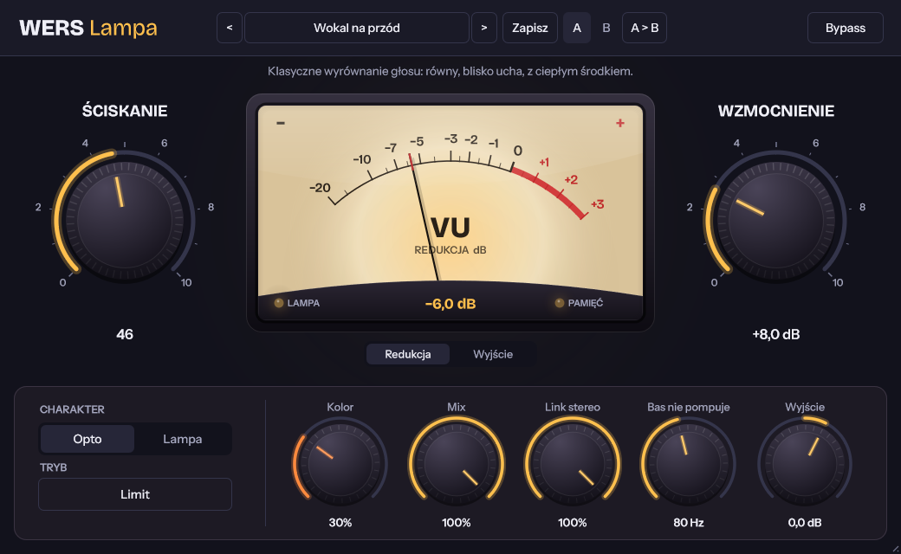

# WERS Lampa



Kompresor z charakterem, VST3 na Windows. To ten, który wrzucasz na wokal, bas albo szynę i od razu brzmi drożej: równo, gęsto i ciepło. Ma tylko kilka dużych gałek. Czasy ataku i zwolnienia ustawia sam, w zależności od tego, co gra.

W środku są dwa charaktery w stylu klasycznych wzmacniaczy wyrównujących:
- **Opto**: komórka optyczna, w której lampka oświetla fotorezystor;
- **Lampa**: kompresor lampowy o zmiennym nachyleniu (variable-mu).

Za komórką jest stopień lampowy z transformatorami, a nad wszystkim duży wskaźnik VU z prawdziwą igłą.

Druga wtyczka kompresora w serii, **WERS Docisk**, jest czysta i precyzyjna. Lampa jest jej przeciwieństwem: mało gałek, dużo charakteru.

## Instalacja

1. Kliknij dwa razy `zainstaluj.bat` w tym folderze. Windows zapyta o zgodę, bo folder `C:\Program Files\Common Files\VST3` wymaga uprawnień administratora.
2. W DAW włącz ponowne skanowanie wtyczek. Szukaj **WERS Lampa** (kategoria Fx / Dynamics).

Bez instalatora wystarczy skopiować cały folder `WERS Lampa.vst3` tam, gdzie DAW szuka wtyczek.

## Jak się tym gra

Klasycznie, dwiema dużymi gałkami:

1. **Ściskanie** kręć w prawo, aż igła w trybie **Redukcja** zacznie schodzić w lewo. 2–4 dB to wyrównanie, 6–10 dB to wyraźna kompresja.
2. **Wzmocnieniem** oddaj to, co zabrało Ściskanie. To podgłośnienie idzie prosto w lampę, więc im więcej, tym bardziej się grzeje.

Reszta:
- **Kolor**: ile dokłada lampa i transformatory, czyli harmoniczne, trochę wagi w dole i miękka góra. Na zero jest prawie czysto, na 100% gęsto i brudno.
- **Mix**: proporcja przetworzonego do oryginału. Poniżej 100% to kompresja równoległa: gęstość bez utraty ataku. Oryginał jest opóźniony tak samo jak sygnał przetworzony, więc nic się nie znosi.
- **Charakter Opto / Lampa**: dwa różne kompresory, opisane niżej. Przełączanie jest płynne.
- **Limit**: wyższy stosunek i szybsza reakcja na szczyty. Z wyrównywania robi się ogranicznik.
- **Link stereo**: na 100% oba kanały ścisza ta sama komórka i obraz stereo stoi w miejscu. Na 0% każdy kanał pracuje osobno.
- **Bas nie pompuje**: filtr górnoprzepustowy przed detektorem, od wyłączonego do 500 Hz. Lampa przestaje reagować na najniższy bas, więc stopa nie ścisza całego miksu. Sam dźwięk się nie zmienia.
- **Wyjście**: głośność na samym końcu, za lampą.
- **Bypass**: płynne przejście do czystego dźwięku, z tym samym opóźnieniem.

Dwuklik na gałce przywraca jej wartość domyślną.

### Wskaźnik VU

Igła ma mechanikę prawdziwego miernika VU: dochodzi do 99% w około 300 ms i lekko przestrzeliwuje, o mniej więcej 1,5%. Skala jest gęsta na dole, jak w oryginale, bo igła porusza się z napięciem, a nie z decybelami.

- **Redukcja** pokazuje, o ile decybeli Lampa ścisza dźwięk. Igła spoczywa na 0 i schodzi w lewo.
- **Wyjście** pokazuje poziom na wyjściu, gdzie 0 VU to −18 dBFS.

Przełączasz przyciskami pod wskaźnikiem albo kliknięciem w samą tarczę. Wybór zapisuje się z projektem. Na płytce pod igłą są dwie lampki:
- **LAMPA** świeci tym mocniej, im mocniej grzeje się stopień lampowy;
- **PAMIĘĆ** pokazuje, ile redukcji komórka trzyma jeszcze w pamięci (o pamięci niżej).

## Presety

26 presetów fabrycznych w grupach. W menu presetów grupy mają nagłówki, a pod nazwą presetu wyświetla się jego krótki opis.

| Grupa | Presety |
|---|---|
| **Start** | Domyślny |
| **Wokal** | Wokal na przód, Wokal jedwab, Rap gęsto, Wokal radiowy, Chórki w tle |
| **Bas** | Bas równy, Bas gruby, 808 w ryzach |
| **Gitara** | Gitara akustyczna, Przester w ryzach, Czysta z sustainem |
| **Bęben** | Stopa i werbel, Overheady razem, Room zgnieciony, Bębny równolegle |
| **Szyna** | Klej na szynę, Szyna bębnów, Szyna wokali |
| **Master** | Master klej, Master ciepło, Master głośno |
| **Kolor** | Tylko lampa, Ciepła taśma, Przegrzany |

Własne presety zapisują się w `%APPDATA%\WERS\presets\lampa`. Sloty A/B pozwalają porównać dwa ustawienia.

W folderze `dema` każdy preset jest wyrenderowany na materiale, który do niego pasuje: presety wokalne na syntetycznym śpiewie o nierównej głośności, basowe na nierówno zagranej linii basu, bębnowe na samych bębnach, a reszta na pętli z cichą zwrotką i głośnym refrenem. Pliki `00 bez efektu` to materiał przed przetworzeniem.

## Jak to działa

**Detektor.** Sygnał przechodzi przez filtr „Bas nie pompuje” i trafia do detektora. Detektor uśrednia moc w kilku milisekundach i jest wyskalowany tak, że sinus czyta swój szczyt. W trybie Limit dochodzi do tego jeszcze szybki detektor szczytów. Link stereo miesza poziom kanału z poziomem głośniejszego z nich.

**Krzywa.** Redukcja to dwa miękkie kolana jedno za drugim. Pierwsze zaczyna kompresję, drugie, kilka dB wyżej, dokłada więcej. Dzięki temu krzywa twardnieje, im mocniej ściska:
- **Opto** przechodzi od 2:1 do około 3,3:1;
- **Opto Limit** przechodzi od 4:1 do 20:1;
- **Lampa** ma bardzo szerokie kolano, które zaczyna pracować wcześniej i łagodniej;
- **Lampa Limit** przechodzi od 2,5:1 do 10:1.

Ściskanie przesuwa próg: od +6 dBFS (nic się nie dzieje) do −50 dBFS.

**Komórka.** Redukcja jest trzymana w dwóch częściach:
- **Szybka część** goni muzykę. Atak zależy od programu: im większy skok, tym szybciej komórka go łapie, jak mocniej rozświetlona lampka.
- **Pamięć** to wolna część. Podczas pracy komórki część redukcji powoli przechodzi do pamięci. Im dłużej i mocniej komórka ściska, tym większy udział pamięci.

Przy zwolnieniu szybka część znika w kilkadziesiąt milisekund, a pamięć gaśnie przez sekundy. Po długiej, mocnej kompresji komórka jest „rozgrzana” i jej ogon gaśnie jeszcze wolniej. Krótki zryw wraca więc od razu, a po długim refrenie zostaje miękki, długi oddech.

Tryb **Lampa** jest szybszy na ataku, ma jedno gładsze i wolniejsze zwolnienie i mniej pamięci. Zmiana charakteru płynnie przechodzi przez wszystkie te wartości.

**Stopień lampowy.** Po komórce i Wzmocnieniu sygnał idzie do lampy, czyli do asymetrycznej krzywej tanh z polaryzacją. Lampa działa przy ośmiokrotnym nadpróbkowaniu (czterokrotnym powyżej 60 kHz, dwukrotnym powyżej 120 kHz). Nadpróbkowanie robią liniowofazowe filtry półpasmowe z oknem Kaisera, dlatego aliasing praktycznie nie istnieje.

Harmoniczne zależą od poziomu: cicho prawie ich nie ma, głośniej rosną, a nieparzyste rosną szybciej niż parzyste.
- **Opto** pochyla krzywą na jedną stronę, jak pojedyncza trioda, więc daje głównie drugą harmoniczną.
- **Lampa** jest prawie symetryczna, jak układ przeciwsobny, więc daje głównie trzecią. Do tego lampę mocniej wysteruje jej własna redukcja, tak jak w prawdziwym kompresorze lampowym.

Kolor ustawia, jak blisko zgięcia krzywej pracuje sygnał. Przy małym sygnale wzmocnienie lampy zawsze wynosi dokładnie 1, więc Kolor nie zmienia głośności, tylko barwę.

**Transformatory.** Najniższy bas lekko się nasyca, jest łagodne podbicie w okolicy 60–70 Hz dla wagi, wysoka półka od 10 kHz miękko zaokrągla górę, a pod muzyką jest filtr podsłyszalny przy 10 Hz. Wszystkiego jest więcej z Kolorem.

**Opóźnienie.** Nadpróbkowanie opóźnia dźwięk o całą liczbę próbek: 52 przy 44,1 i 48 kHz. Wtyczka zgłasza to opóźnienie DAW, więc DAW je wyrównuje. Mix i bypass używają oryginału opóźnionego o tyle samo.

Wszystkie gałki są wygładzane, więc nic nie klika. Wątek audio nic nie alokuje.

## Budowanie

Lampa to samodzielny projekt CMake w tym folderze. Korzysta ze wspólnego wyglądu serii z `../../libs/ui`.

```
cmake -S . -B build -G "Visual Studio 17 2022" -A x64
cmake --build build --config Release
build\Release\lampa_dsp_tests.exe
build\Release\lampa_plugin_tests.exe
```

Szybciej, z lokalnymi kopiami JUCE i doctest: `-DFETCHCONTENT_SOURCE_DIR_JUCE=<folder>` i `-DFETCHCONTENT_SOURCE_DIR_DOCTEST=<folder>`.

Dodatkowe programy:
- `lampa_ui_shots <folder>` robi zrzuty okna przy grającej muzyce;
- `lampa_render <folder> [plik.wav]` przepuszcza plik (albo syntetyczny materiał) przez wszystkie presety i wypisuje poziomy, szczyty, crest factor i największą redukcję każdego renderu.

### Co sprawdzają testy

Testy DSP (20 przypadków, ponad 2 miliony asercji):
- Nadpróbkowanie jest płaskie od 50 Hz do 18 kHz i opóźnia o całą liczbę próbek, bez błędu fazy (lepiej niż −60 dB). Ton 15 kHz przechodzi bez żadnych obrazów (resztki poniżej −100 dB).
- Redukcja w funkcji poziomu we wszystkich czterech trybach:
  - poniżej kolana nie ma żadnej redukcji;
  - redukcja rośnie monotonicznie;
  - powyżej progu jest bardziej stroma niż w kolanie;
  - nachylenie przy 0 dBFS mieści się w zakresie trybu: Opto 0,55–0,8, Limit powyżej 0,88.
- Kolano Lampy zaczyna pracować wcześniej niż Opto. Limit ściska mocniej, a więcej Ściskania daje więcej redukcji.
- Poziom wyjścia zgadza się z redukcją, a Wzmocnienie i Wyjście dodają dokładnie tyle, ile pokazują.
- Atak zależy od programu: duży skok jest łapany wyraźnie szybciej niż mały.
- Zwolnienie zależy od programu. Po krótkim zrywie Opto wraca poniżej 1 dB w około 0,18 s, a po trzech sekundach kompresji dopiero po około 2,5 s.
- Zwolnienie jest dwuetapowe: po 150 ms znika ponad 20% redukcji, a po sekundzie zostają jeszcze ponad 2 dB.
- Mocniejsza kompresja zostawia większą pamięć.
- Filtr detektora na 200 Hz praktycznie wyłącza reakcję na 50 Hz, a tonu 2 kHz nie zmienia.
- Link stereo: połączone kanały ściszają się razem, rozłączone osobno, a 50% leży pośrodku.
- Kolor na zero daje zniekształcenia poniżej −60 dB. Każde ćwierć gałki dodaje co najmniej 4 dB harmonicznych.
- Opto daje głównie drugą harmoniczną, Lampa głównie trzecią.
- Harmoniczne rosną z poziomem, a nieparzyste rosną szybciej. Lampa mocniej się grzeje pod własną redukcją.
- Aliasing: ton 15 kHz przy pełnym Kolorze daje resztki od −100 do −116 dB, a ton 7 kHz około −135 dB. Przy 44,1 i 96 kHz resztki są poniżej −80 dB.
- Transformatory przy pełnym Kolorze dają około +1,2 dB przy 70 Hz i około −1,6 dB przy 16 kHz, a przy zerowym Kolorze mniej niż 0,5 dB.
- Mix na zero i bypass dają wejście próbka w próbkę, opóźnione o zgłoszone opóźnienie. Wynik jest wyrównany z oryginałem przy każdej częstotliwości próbkowania od 22 do 192 kHz.
- Ruszanie wszystkimi gałkami i przełącznikami w trakcie grania nie klika.
- Losowe skrajne ustawienia przy 22–192 kHz nigdy nie dają NaN, a przetwarzanie nic nie alokuje.
- Wskaźnik: 0 VU to −18 dBFS, odczyt redukcji zgadza się z komórką, a igła dochodzi do 99% w około 290 ms i przestrzeliwuje o około 1,4%, niezależnie od liczby klatek.

Testy wtyczki (11 przypadków):
- Każdy z 26 presetów gra czysto na swoim materiale, w granicach ±4 dB od wejścia i bez szczytów powyżej 1 dBFS. Jest wszystkie 7 grup, a każdy preset ma opis.
- Preset wokalny zmniejsza skok głośności między cichą zwrotką a głośnym refrenem o ponad 3 dB.
- Równoległe bębny podnoszą ciało między uderzeniami względem samych uderzeń.
- Wtyczka zgłasza opóźnienie. Stan projektu wraca w całości, razem z trybem wskaźnika, a uszkodzony stan jest ignorowany.
- Bypass, także ten z DAW, płynnie wraca do oryginału.
- Mono działa. Nie ma alokacji ani przy przetwarzaniu, ani przy zmianie presetów. Działają dziwne długości bloków i częstotliwości próbkowania.
- Okno się otwiera, a interakcje myszką działają:
  - kliknięcie w tarczę przełącza wskaźnik;
  - przeciąganie dużej gałki zmienia Ściskanie;
  - przyciski Opto/Lampa i Limit ustawiają swoje parametry;
  - opis presetu się pojawia;
  - okno się skaluje.
- Bypass nie zapisuje się w presetach.

pluginval na rygorze 10 przechodzi, a walidator VST3 Steinberga przechodzi 47 z 47 testów.
