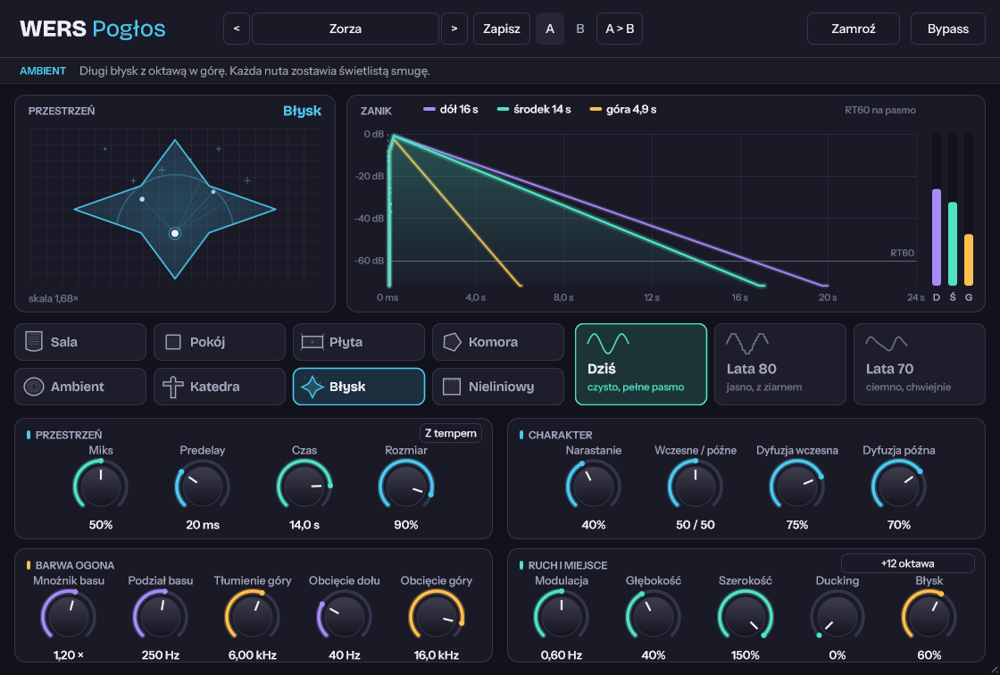

# WERS Pogłos



Algorytmiczny pogłos VST3 na Windows z serii WERS. Gęsty, gładki i bujny, bez metalicznego dzwonienia. Ma osiem algorytmów, każdy z własną budową i barwą, trzy epoki brzmienia i 60 presetów fabrycznych w dziesięciu grupach. Wszystko liczy sam: żadnych odpowiedzi impulsowych z zewnątrz, tylko nasza matematyka.

Pokrętło **Czas** to prawdziwy RT60: ogon w środku pasma cichnie o 60 dB dokładnie po tylu sekundach, ile pokazuje gałka. Testy mierzą to na odpowiedzi impulsowej.

## Instalacja

1. Kliknij dwa razy `zainstaluj.bat` w tym folderze. Windows zapyta o zgodę, bo folder `C:\Program Files\Common Files\VST3` wymaga uprawnień administratora.
2. W DAW włącz ponowne skanowanie wtyczek. Szukaj **WERS Poglos** (kategoria Fx / Reverb).

Bez instalatora wystarczy skopiować cały folder `WERS Poglos.vst3` tam, gdzie DAW szuka wtyczek.

Plik i nazwa na liście wtyczek są bez „ł”. Nazwa trafia do pliku przez wiersz poleceń kompilatora, a ten zamienia „ł” na znak, którego część programów nie umie odczytać: pluginval i walidator Steinberga nie wczytywały takiej wtyczki. W samym oknie wtyczki widać pełną nazwę **Pogłos**.

## Jak się tym gra

**Algorytm** wybierasz z ośmiu kafelków. Każdy ma rysunek swojej przestrzeni:

| Algorytm | Co to jest |
|---|---|
| **Sala** | Sala koncertowa. Dalekie odbicia boczne, szeroka sieć średnich linii i łagodny chorus. Do wszystkiego. |
| **Pokój** | Krótko i blisko, z mocnymi, gęstymi odbiciami. Nagranie przestaje brzmieć jak z szafy. |
| **Płyta** | Płyta pogłosowa: bez odbić, gęsta od pierwszej chwili, jasna i chuda w dole. Wokal i werbel. |
| **Komora** | Betonowa komora pogłosowa. Twarde ściany, odbicia parami, wysunięty środek pasma, prawie bez ruchu. |
| **Ambient** | Odbić nie słychać, dźwięk po prostu robi się większy. Krótki jest niewidzialny, długi to chmura. |
| **Katedra** | Bardzo długie linie, dalekie odbicia i powolne narastanie. |
| **Błysk** | Duża sala, której ogon wraca podniesiony o interwał: oktawę, kwintę, dwie oktawy albo oktawę w dół. |
| **Nieliniowy** | Gęsta chmura z własną obwiednią, ucięta na końcu bramki. Pogłos bramkowany i odwrócony. |

**Epoka** to charakter urządzenia, w którym taki pogłos mógłby powstać:
- **Dziś**: czysto, pełne pasmo, gładka modulacja z odrobiną przypadku.
- **Lata 80**: jasna góra urwana przed powietrzem i krótkie słowo cyfrowe (13 bitów). W cichym końcu ogona słychać ziarno, jak we wczesnych cyfrowych pogłosach. Do tego wyraźny chorus.
- **Lata 70**: ciemno, wąskie pasmo i szumiąca, nierówna modulacja.

Przełączanie algorytmów i epok jest płynne: pogłos wycisza się w 25 ms, przestawia i wraca. Nic nie klika.

**Wyświetlacz ZANIK** pokazuje, jak gaśnie ogon w trzech pasmach: dół (fiolet), środek (mięta) i góra (bursztyn). Linia przerywana to predelay, krótkie kreski na początku to wczesne odbicia, a narastanie widać jako łagodny start krzywej. W legendzie jest RT60 każdego pasma, a z prawej trzy mierniki: poziom pogłosu na żywo w tych samych pasmach. Krzywe liczą się tym samym wzorem co silnik, więc pokazują to, co naprawdę usłyszysz.

**Wyświetlacz PRZESTRZEŃ** pokazuje pomieszczenie z góry. Obrys rośnie z rozmiarem, kropki to wczesne odbicia (dalej znaczy później), a z miejsca źródła rozchodzą się kręgi, póki ogon gra. Przy zamrożeniu wszystko robi się lodowe.

### Pokrętła

**Przestrzeń**
- **Miks**: ile pogłosu względem suchego dźwięku, z równą mocą. Na wysyłce (aux) ustaw 100%.
- **Predelay**: od 0 do 500 ms przerwy przed pogłosem. Przycisk **Z tempem** zamienia go na wartości nut (1/64 do 1/2, z triolami i kropkami) w tempie utworu.
- **Czas**: RT60 w środku pasma, od 0,1 do 30 s. W algorytmie Nieliniowy to długość bramki.
- **Rozmiar**: wielkość przestrzeni, czyli odstępy odbić i długości linii. Czas pogłosu się nie zmienia.

**Charakter**
- **Narastanie**: jak powoli pogłos wzbiera, do 350 ms. W algorytmie Nieliniowy to **Kształt** bramki: w lewo opadający, w środku płaski, w prawo odwrócony.
- **Wczesne / późne**: proporcja odbić do ogona.
- **Dyfuzja wczesna**: ostre, osobne odbicia albo gładki, rozmyty początek.
- **Dyfuzja późna**: ziarnisty ogon z echem albo gładki jak jedwab.

**Barwa ogona**
- **Mnożnik basu** i **Podział basu**: czas pogłosu poniżej podziału względem środka, od 0,25× do 4×.
- **Tłumienie góry**: powyżej tej częstotliwości ogon gaśnie szybciej, aż do czterech razy na samej górze.
- **Obcięcie dołu** i **Obcięcie góry**: filtry na samym pogłosie. Suchy dźwięk zostaje nietknięty.

**Ruch i miejsce**
- **Modulacja** i **Głębokość**: linie opóźniające pływają, każda w swoim tempie. Ruch rozmywa rezonanse, więc ogon nie dzwoni. Głęboka modulacja daje chorus.
- **Szerokość**: od mono (0%) do szerzej niż natura (150%).
- **Ducking**: ścisza pogłos nawet o 30 dB, kiedy gra źródło, i oddaje go w przerwach. Obok wartości widać, ile ścisza w tej chwili.
- **Błysk** i interwał: ile podniesionego ogona wraca do pogłosu. Działa w algorytmie Błysk, interwał zmienia się kliknięciem.

**Zamroź** zatrzymuje ogon na zawsze i przestaje przyjmować nowy dźwięk. Po puszczeniu ogon gaśnie zwyczajnie. Zamrożenie i bypass nie zapisują się w presetach.

Każde pokrętło ma podpowiedź po polsku, a dwuklik przywraca wartość domyślną. Okno można powiększać i zmniejszać, a jego rozmiar zapisuje się w projekcie.

## Presety

60 presetów fabrycznych w grupach:

| Grupa | Presety |
|---|---|
| **Start** | Czysta sala |
| **Wokal** | Wokal: jedwabna płyta, Wokal: sala w tle, Wokal: bliski pokój, Wokal: ballada, Wokal: eko lat 80, Wokal: chór w kościele, Wokal: rap na sucho |
| **Bębny** | Werbel: bramka lat 80, Werbel: jasna płyta, Perkusja: pokój, Stopa: ciasna komora, Bęben odwrócony, Blachy w hali, Loop z lat 70 |
| **Gitara** | Gitara: sprężynowa jasność, Gitara akustyczna, Gitara: szeroka sala, Solo w stadionie, Gitara: kraut z lat 70 |
| **Syntezator** | Pad: nieskończona sala, Lead z lat 80, Arpeggio w szkle, Bas z przestrzenią, Pluck na hali, Błyszczący pad |
| **Ambient** | Mgła, Zorza, Głęboka woda, Kwinty w chmurach, Bezkres, Taśma z lat 70 |
| **Przestrzenie** | Filharmonia, Kamienna katedra, Mały pokój, Studio z drewna, Betonowa komora, Klatka schodowa, Hangar, Kafelki w łazience, Niewidzialny pokój |
| **Płyty** | Płyta złota, Płyta ciemna, Płyta krótka, Płyta z lat 80, Płyta z lat 70, Płyta szeroka |
| **Efekty** | Odwrócony oddech, Bramka z gniazdka, Zamrożony akord, Anielski chór, Kosmiczne echo, Dwie oktawy wyżej, Lo-fi taśma |
| **Miks** | Szyna: sala, Szyna: płyta, Szyna: pokój, Klej do miksu, Głębia za sceną, Do przodu |

Presety z grupy **Miks** o nazwie „Szyna” są do wysyłki: mają 100% pogłosu.

Lista presetów otwiera się pogrupowana: każda grupa to osobne podmenu. Pod nagłówkiem okna widać grupę i jednozdaniowy opis wczytanego presetu. Własne presety zapisują się w `%APPDATA%\WERS\presets\poglos`. Sloty A/B pozwalają porównać dwa ustawienia.

W folderze `dema` jest każdy preset wyrenderowany na tym samym materiale: cztery takty pętli z melodią, a potem sześć sekund ciszy, w której słychać sam ogon. Plik `00 bez efektu.wav` to materiał bez pogłosu.

## Jak to działa

Sygnał idzie tą drogą:

1. **Predelay**: bufor do 1 s. Przy ruchu predelay płynnie przesuwa się do celu, a potem staje na pełnej próbce, więc nic nie gubi góry.
2. **Wczesne odbicia**: od 6 do 24 odczepów na kanał, w czasach i ze stronami typowymi dla danego algorytmu. Ich energia jest unormowana, a potem rozmywają je dwa filtry wszechprzepustowe.
3. **Dyfuzja wejściowa**: od 4 do 6 filtrów wszechprzepustowych na kanał. Rozmazują początek, zanim dźwięk wejdzie do sieci.
4. **Narastanie**: osiem odczepów z rosnącą wagą. Ogon wzbiera przez zadany czas.
5. **Sieć opóźnień ze sprzężeniem (FDN)**: 16 linii o długościach rozłożonych logarytmicznie, każda inna, mieszanych macierzą Hadamarda 16×16. Jest ortogonalna, więc sama niczego nie traci ani nie dodaje.
   - W każdej linii siedzą jeden albo dwa filtry wszechprzepustowe (dyfuzja późna). Dzięki nim gęstość echa szybko dochodzi do poziomu szumu.
   - Linie są modulowane sinusem i wygładzonym przypadkiem. Odczyt idzie przez interpolację wszechprzepustową, która nie tłumi żadnej częstotliwości.
   - Nawet przy zerowej głębokości zostaje niesłyszalne, drobne błądzenie. Nieruchoma sieć zachowałaby swoje rezonanse.
6. **Straty w pętli**: każda linia ma wzmocnienie środka i dwie półki pierwszego rzędu, dolną (mnożnik basu) i górną (tłumienie). Wzmocnienia liczą się z długości danej linii tak, żeby RT60 wyszło dokładnie takie, jak każą pokrętła. Półki trochę „przeciekają” na środek, więc wzmocnienie środka jest dobierane tak, żeby przy 1 kHz RT60 było równe gałce co do milisekundy. Żadna częstotliwość nie dostaje wzmocnienia powyżej 1.
7. **Nieliniowy** dodaje chmurę 48 odczepów na kanał rozłożonych na długości bramki, z obwiednią: opadającą, płaską albo rosnącą jak odwrócony ogon. Zamrożenie przełącza go na sieć.
8. **Błysk** to dwie przenikające się głowice odczytu (okno 60 ms), które przesuwają ogon o interwał. Przesunięty ogon wraca do sieci przez filtry.
9. **Wyjście**: korekcja barwy algorytmu i epoki, obcięcie dołu i góry, 13-bitowe słowo epoki lat 80, szerokość M/S, ducking i miks.

Zamrożenie ustawia wszystkie straty na zero i płynnie zamyka wejście. Sieć jest wtedy bezstratna i trzyma dźwięk bez końca. Wszystkie parametry są wygładzane, a silnik po `prepare()` niczego nie alokuje.

## Budowanie

Pogłos to osobny projekt CMake:

```
cd plugins/poglos
cmake -S . -B build -G "Visual Studio 17 2022" -A x64 -DFETCHCONTENT_SOURCE_DIR_JUCE=<juce> -DFETCHCONTENT_SOURCE_DIR_DOCTEST=<doctest>
cmake --build build --config Release --target WersPoglos_VST3 pog_dsp_tests pog_plugin_tests
build\Release\pog_dsp_tests.exe
build\Release\pog_plugin_tests.exe
```

Bez lokalnych kopii JUCE i doctest pobiorą się same. Dodatkowe programy:
- `pog_ui_shots <folder>` robi zrzuty okna;
- `pog_render <folder> [plik.wav]` przepuszcza plik (albo materiał demo) przez wszystkie presety i wypisuje ich poziomy.

### Co sprawdzają testy

Testy DSP (18 przypadków, 218 asercji) mierzą odpowiedzi impulsowe:
- **RT60 w środku pasma** (oktawa wokół 1 kHz, metoda Schroedera, T20) zgadza się z pokrętłem Czas z dokładnością do 8%. Sprawdzane jest 11 ustawień, od 0,4 s w Pokoju do 9 s w Katedrze. Typowo wynik różni się o 1–4%.
- **RT60 w dole i w górze** (oktawy 88 Hz i 10 kHz) zgadza się z tym, co obiecuje wyświetlacz, z dokładnością do 12%. Środek zostaje na gałce nawet przy mocnych półkach, a mnożnik basu 2× i 0,4× działa w obie strony.
- **Gęstość echa**: znormalizowana gęstość (Abel i Huang) już po 120 ms wynosi 0,99–1,01 w każdym algorytmie, czyli tyle co szum. W bramce wynosi 0,93.
- **Brak dzwonienia**: uśrednione widmo ogona z obu kanałów, z odjętym zanikiem. Żaden prążek nie wystaje więcej niż 6,5 dB ponad gładki kształt widma, a płaskość widma przekracza 0,88. Sprawdzane w siedmiu algorytmach, z modulacją i bez niej.
- **Dekorelacja**: korelacja lewego i prawego ogona ze źródła mono nie przekracza 0,25 (w praktyce około 0,01). Szerokość 0% daje czyste mono.
- **Predelay** przesuwa całą odpowiedź dokładnie o swój czas, co do próbki.
- **Zamrożenie** trzyma poziom przez 10 s z dokładnością do 1 dB, nie wpuszcza nowego dźwięku, a po puszczeniu ogon gaśnie o ponad 40 dB.
- **Bez kliknięć**: przełączanie wszystkich algorytmów i epok oraz kręcenie każdym pokrętłem i zamrożeniem w trakcie grania nie daje skoków.
- **Skrajne ustawienia** przy 22,05, 44,1, 48, 96 i 192 kHz zawsze dają skończony wynik w rozsądnych granicach. Błysk na 100% przy 30 s zostaje ograniczony i gaśnie.
- Błysk dodaje oktawę wyżej, a bramka ma swój kształt i naprawdę się zamyka.
- Ducking ścisza o 30 dB i oddaje pogłos po przerwie.
- Lata 70 są ciemniejsze, a lata 80 mają 13-bitowe słowo.
- Wczesne/późne, narastanie, rozmiar i obcięcia robią to, co mówią.
- Algorytmy grają na podobnej głośności, a silnik nic nie alokuje, nawet przy zmianie algorytmu.

Testy wtyczki (12 przypadków, 1831 asercji):
- jest co najmniej 50 presetów, w wymaganych grupach, z niepowtarzalnymi nazwami, opisami i wartościami w zakresach;
- każdy preset gra czysto i trzyma rozsądny poziom;
- stan projektu wraca w całości, a uszkodzony albo losowy stan jest ignorowany;
- bypass płynnie wraca do suchego dźwięku, a źródło mono daje stereofoniczny pogłos;
- predelay z tempem liczy się z tempa hosta;
- zmiana presetów w trakcie grania niczego nie alokuje;
- bloki od 1 do 3000 próbek przy 22–192 kHz działają;
- zamrożenie i bypass nie należą do presetów;
- lista presetów ma dziesięć podmenu ze wszystkimi presetami, a pod nagłówkiem pojawia się opis wczytanego;
- edytor się otwiera, a kafelki algorytmów i epok, Zamroź, Z tempem, interwał Błysku i przeciąganie pokrętła Czas działają myszą;
- wyświetlacz rysuje dokładnie te czasy, które daje silnik.

pluginval na rygorze 10 przechodzi (SUCCESS), a walidator VST3 Steinberga przechodzi 47 z 47 testów.
