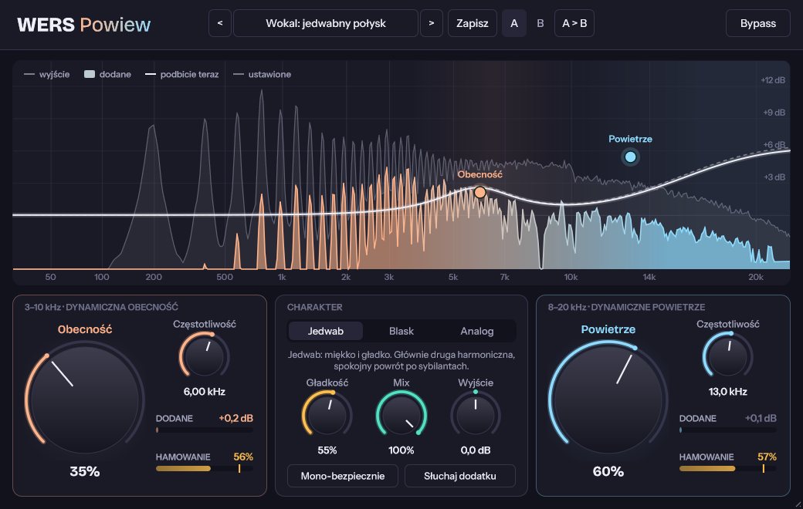

# WERS Powiew



Wtyczka serii WERS: dynamiczny „powiew” na górze pasma, VST3 na Windows. Dwa duże pokrętła, **Obecność** i **Powietrze**, sprawiają, że wokal, gitara, perkusja albo cały miks brzmią jaśniej, bardziej otwarcie i drożej. Bez ostrości i bez syczenia: wbudowany detektor sam cofa podbicie na sybilantach, talerzach i materiale, który już jest jasny.

Najważniejsze zasady:
- **Na zerze nic się nie dzieje.** Oba pokrętła na 0% dają dokładnie wejście, próbka w próbkę (przesunięte o stałe opóźnienie, które DAW sam wyrównuje).
- **Dół zostaje nietknięty.** Wszystko, co Powiew robi, dzieje się nad 2–3 kHz.
- **Nic nie aliasuje.** Harmoniczne powstają przy czterokrotnej częstotliwości próbkowania.

## Instalacja

1. Kliknij dwa razy `zainstaluj.bat` w tym folderze. Windows zapyta o zgodę, bo folder `C:\Program Files\Common Files\VST3` wymaga uprawnień administratora.
2. W DAW włącz ponowne skanowanie wtyczek. Szukaj **WERS Powiew** (kategoria Fx / EQ).

Bez instalatora wystarczy skopiować cały folder `WERS Powiew.vst3` tam, gdzie DAW szuka wtyczek.

## Jak się tym gra

**Obecność** (3–10 kHz) to wyrazistość: dykcja, atak, kontur. **Powietrze** (od 8 kHz w górę) to przestrzeń, oddech i połysk. Każde pokrętło podnosi naraz dwie rzeczy:
- **dynamiczny korektor**: dzwon dla obecności, łagodną półkę dla powietrza;
- **ekscyter**: z pasma poniżej powstają nowe, wyższe harmoniczne. To one „robią” górę tam, gdzie nagranie jej nie ma.

Małe pokrętło **Częstotliwość** w każdej karcie przesuwa pasmo. Wokal zwykle 4–7 kHz obecności i 12–15 kHz powietrza; werbel i gitara 5–6 kHz; master 14–16 kHz.

**Gładkość** decyduje, jak mocno podbicie się cofa:
- 0%: zawsze tyle samo, jak zwykły korektor z ekscyterem;
- 50%: cofa się na sybilantach i talerzach, wokal i instrumenty dostają pełny powiew;
- 100%: góra pilnowana bardzo krótko, do szeptu, podcastów i ostrych nagrań.

Detektor patrzy 1,5 ms do przodu, więc zaczyna hamować, zanim „s” dotrze do wyjścia. Hamuje w ułamku milisekundy, a wraca muzycznie (45–70 ms, zależnie od charakteru). Na atakach (stopa, werbel, szarpnięcie struny) podbicie na chwilę rośnie, więc uderzenia błyszczą, a wybrzmienia zostają spokojne.

**Charakter**:
- **Jedwab**: miękko i gładko. Głównie druga harmoniczna, spokojny powrót po sybilantach.
- **Blask**: jaśniej i szybciej. Nieparzyste harmoniczne, więcej podbicia, mocniej reaguje na ataki.
- **Analog**: najwięcej harmonicznych, mniej korekcji. Gęsta, ciepła góra jak ze sprzętu.

**Mix** wmiesza dodatek równolegle, **Wyjście** to głośność.

**Mono-bezpiecznie**: dodatek powstaje tylko ze środka i trafia jednakowo do obu kanałów. Boki zostają nietknięte, a suma mono jest pewna. Na master i podcasty.

**Słuchaj dodatku**: słyszysz tylko to, co Powiew dodaje, bez oryginału. Najlepszy sposób, żeby usłyszeć, czy na „s” rzeczywiście nic nie przybywa. Nie zapisuje się w presetach.

### Co widać

W dużym oknie:
- szare widmo to wyjście;
- kolorowe widmo (od brzoskwiniowego do lodowego) to to, co Powiew dodaje;
- linia przerywana to podbicie ustawione pokrętłami, a ciągła to podbicie, które detektor przepuszcza w tej chwili. Gdy na „s” ciągła linia opada, widać hamowanie.

Dwa uchwyty, **Obecność** i **Powietrze**, można przeciągać: w bok zmienia częstotliwość, w górę i w dół ilość. Shift przesuwa pięć razy dokładniej, dwuklik ustawia zero.

Każda karta pasma ma dwa mierniki:
- **Dodana energia**: o ile dB pasmo wyszło głośniejsze niż weszło;
- **Hamowanie**: ile podbicia detektor właśnie zabrał (bursztynowa kreska chwilę trzyma szczyt).

## Presety

22 presety fabryczne w grupach:

| Grupa | Presety |
|---|---|
| **Start** | Neutralnie, Pierwszy powiew |
| **Wokal** | Wokal: jedwabny połysk, Wokal pop z przodu, Szept i oddech, Chórki w powietrzu, Rap: dykcja |
| **Akustyk** | Gitara akustyczna: struny, Fortepian: otwarcie, Smyczki: jedwab |
| **Bębny** | Blachy: połysk, Werbel: atak, Overheady: przestrzeń |
| **Miks** | Miks: więcej powietrza, Ciemny miks: rozjaśnij, Syntezatory: blask |
| **Master** | Master: subtelny powiew, Master: drogi połysk, Master: analogowe ciepło góry |
| **Podcast** | Podcast: czytelność, Podcast: radiowy głos, Mikrofon z laptopa: ratunek |

Własne presety zapisują się w `%APPDATA%\WERS\presets\powiew`. Sloty A/B pozwalają porównać dwa ustawienia.

W folderze `dema` jest każdy preset wyrenderowany na materiale, do którego pasuje: presety wokalne, podcastowe i startowe na syntetycznym głosie z sybilantami („sa”, „si”, „o-sz”, „e”), pozostałe na pętli z gitarą, basem, stopą i hi-hatem. Obok leżą oba nagrania bez efektu.

## Jak to działa

Sygnał idzie trzema drogami:
1. **Opóźniony oryginał.** Opóźnienie (1,5–1,75 ms) daje detektorowi czas, żeby zobaczyć sybilant, zanim ten dojdzie do wyjścia.
2. **Korektor równoległy.** Dzwon (obecność) i półka (powietrze) są ustawione na stałe +12 dB, a do oryginału dokłada się tylko ich różnicę, pomnożoną przez ilość z pokrętła i detektora. Przy zerze dokłada się dokładnie nic. Półka ma dobroć 0,58, więc przy żadnej ilości nie robi dołka pod sobą.
3. **Ekscyter.** Pasmo poniżej (dla obecności od ok. ⅓ do ¾ częstotliwości, dla powietrza od ok. ⅓ do ¾ częstotliwości półki) jest podnoszone do czterokrotnej częstotliwości próbkowania filtrami półpasmowymi (Kaiser, ok. 100 dB tłumienia). Tam sygnał, znormalizowany przez własną obwiednię, przechodzi przez wielomiany Czebyszewa: T2 daje czystą drugą harmoniczną, T3 trzecią i tak dalej. Dlatego proporcja harmonicznych nie zależy od głośności. Potem filtr górnoprzepustowy 4. rzędu zostawia tylko nowe harmoniczne nad pasmem źródłowym.

Detektor porównuje energię pasma obecności i pasma powietrza z energią „ciała” dźwięku (200 Hz–3 kHz). Gdy pasmo jest jaśniejsze niż próg ustawiony Gładkością, podbicie cofa się miękko według 1 / (1 + (stosunek / próg)³). Obie drogi, korektor i ekscyter, słuchają tego samego detektora. Detektor bierze oba kanały naraz, więc obraz stereo się nie chwieje. Wszystkie pokrętła, częstotliwości, charakter i przełączniki przechodzą płynnie, więc nic nie klika.

## Budowanie

Powiew to samodzielny projekt CMake w tym folderze:

```
cmake -S . -B build -G "Visual Studio 17 2022" -A x64 -DFETCHCONTENT_SOURCE_DIR_JUCE=<juce> -DFETCHCONTENT_SOURCE_DIR_DOCTEST=<doctest>
cmake --build build --config Release --target WersPowiew_VST3 pow_dsp_tests pow_plugin_tests
build\Release\pow_dsp_tests.exe
build\Release\pow_plugin_tests.exe
```

Dodatkowe programy:
- `pow_ui_shots <folder>` robi zrzuty okna z grającym dźwiękiem;
- `pow_render <folder> [plik.wav]` przepuszcza plik (albo głos i pętlę demo) przez wszystkie presety i wypisuje poziomy pasm.

### Co sprawdzają testy

28 przypadków testowych (18 dla samego DSP, 10 dla całej wtyczki), mierzonych na sygnałach:

- Oba pokrętła na zero: wyjście to wejście przesunięte o opóźnienie, bit w bit, przy każdym charakterze, z mono-bezpiecznym trybem i bez.
- Opóźnienie jest takie, jakie wtyczka zgłasza DAW, przy 22–192 kHz. Nadpróbkowanie w obie strony to czyste opóźnienie (błąd poniżej 0,0002 do 18 kHz).
- Korektor robi dokładnie to, co rysuje krzywa (różnica poniżej 0,35 dB od 150 Hz do 19 kHz), nigdy nie schodzi pod poziom suchego sygnału, a 150 Hz zostaje bez zmian.
- Każde pokrętło dodaje energię w swoim paśmie: Obecność ponad 4 dB w 5–8 kHz, Powietrze ponad 4,5 dB w 14–19 kHz, a pasmo 50–1000 Hz rusza się o mniej niż 0,1 dB.
- Ekscyter tworzy nowe harmoniczne, których w wejściu nie było: Jedwab z przewagą drugiej, Blask z przewagą trzeciej, Analog z największą ich ilością.
- Aliasing przy 44,1 kHz: harmoniczne, które spadłyby z powrotem w pasmo, są ponad 110 dB pod tonem. Ten sam ekscyter bez nadpróbkowania aliasuje na poziomie około −14 dB, więc test widzi aliasing, kiedy jest.
- Głos z sybilantami: przy Gładkości 60% samogłoski dostają ponad 2,5 dB góry (najwyżej 1 dB mniej niż bez dynamiki), a „s” i „sz” mniej niż 1 dB (bez dynamiki ponad 2 dB).
- Na białym szumie, czyli materiale już jasnym, podbicie cofa się prawie do zera.
- Dynamika nie zależy od głośności: ten sam głos 20 dB ciszej dostaje te same wartości w granicach 0,5 dB.
- Na atakach dodatek jest większy niż w wybrzmieniu.
- Mono-bezpiecznie: czyste boki przechodzą bit w bit, a przy stereo boki wyjścia są równe bokom wejścia.
- Słuchaj dodatku, Mix i Wyjście robią dokładnie to, co mówią: wynik minus sam dodatek to suchy sygnał, 50% mixu to połowa dodatku, +6 dB to podwójny sygnał.
- Bypass płynnie przechodzi do suchego sygnału z tym samym opóźnieniem, także przez bypass hosta.
- Przestawianie wszystkich pokręteł, częstotliwości, charakteru i przełączników w trakcie grania nie klika: poniżej 300 Hz zostaje mniej niż 0,001, a twardy skok głośności daje tam wyraźnie więcej.
- Skrajne ustawienia przy 22–192 kHz, cisza i sygnał ±8 nigdy nie dają NaN, a wątek audio nic nie alokuje, także przy zmianie presetów.
- Każdy z 22 presetów gra czysto na pętli i na głosie, w rozsądnej głośności, z opisem. Stan projektu wraca w całości, a uszkodzony stan jest ignorowany.
- Mono wejście i wyjście działa, inne układy są odrzucane, a nietypowe bloki i częstotliwości próbkowania działają.
- Okno: przeciąganie uchwytów zmienia ilość i częstotliwość, Shift daje piątą część ruchu, dwuklik zeruje, a charakter, przyciski i pokrętła ustawiają swoje parametry. Mierniki pokazują dodaną energię i hamowanie na sybilantach, a okno się skaluje.
- pluginval na rygorze 10 przechodzi, a walidator VST3 Steinberga przechodzi 47 z 47 testów.
